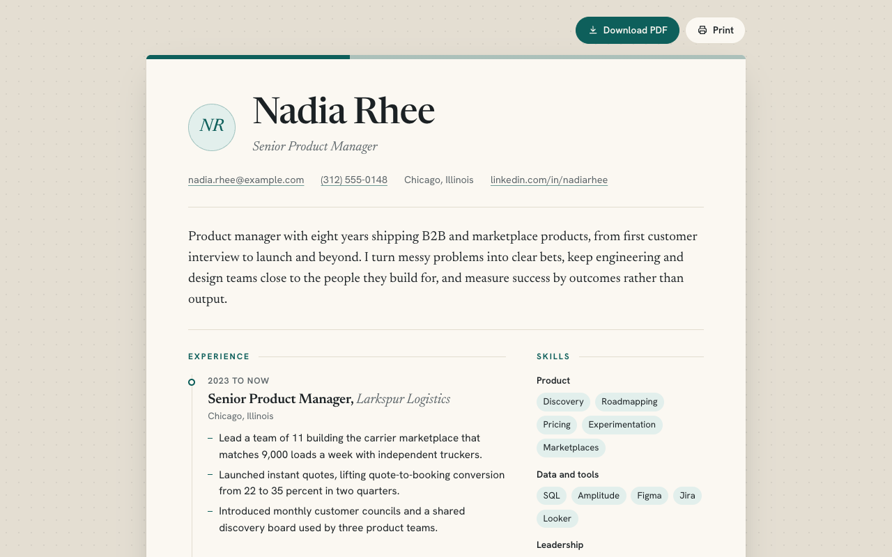

# Resume

A one-page online resume in plain HTML and CSS that prints as a clean, one-page CV. No framework, no build tools, nothing to update.



[](https://console.cloudzyro.com/new?repo=https://github.com/Cloudzyro/template-resume)

## What's included

- One page: name and role, contact details, summary, experience timeline, selected projects, skills, education, extras and a contact note
- Print-friendly CSS: Print (or Save as PDF) gives a clean, single US Letter page with no buttons or background (it also fits A4)
- "Download PDF" button linking to `resume.pdf` (a sample is included; replace it with yours)
- Light and dark themes that follow the visitor's device; printing is always light
- Self-hosted fonts (Newsreader and Hanken Grotesk, SIL Open Font License), so there are no outside requests
- SEO: title, description, canonical link, Open Graph and Twitter tags, a social image, `sitemap.xml`, `robots.txt` and a favicon
- Responsive down to 360px, semantic HTML, keyboard friendly, respects reduced motion
- The only JavaScript is three lines in `print.js` for the Print button

## Run it locally

The `site/` folder is the whole website. Open `site/index.html` in a browser, or:

```bash
pnpm install    # nothing to download; sets up pnpm
pnpm dev        # serve site/ at http://localhost:3000
pnpm build      # copy site/ to dist/
pnpm preview    # serve dist/
```

`pnpm build` uses only Node.js (no dependencies). It copies `site/` to `dist/`, and if `SITE_URL` is set it puts your address into the canonical link, social tags, `robots.txt` and `sitemap.xml`:

```bash
SITE_URL=https://yourname.com pnpm build
```

## Make it yours

- **Your content:** everything is in `site/index.html`. Change the words between the tags; each section is clearly marked. Add or remove `<li>` items to add jobs, bullet points, projects or skills.
- **Your PDF:** replace `site/resume.pdf` with your own. The easiest way is to open your finished page, press Print and choose Save as PDF. To use another file name, change the link in the toolbar at the top of `index.html`.
- **Site address:** set `SITE_URL` when building (see above), or replace `https://example.com` in `index.html`, `robots.txt` and `sitemap.xml`.
- **Colors:** the variables at the top of `site/styles.css` (`--accent`, `--paper`, `--ink` and friends); the dark theme has its own set just below.
- **Fonts:** the `@font-face` rules at the top of `styles.css` point to the files in `site/fonts/`. Swap in other `.woff2` files to change them.
- **Monogram and favicon:** the initials in the header and `site/favicon.svg`.
- **Social image:** `site/og.png` (1200 by 630). Replace it with any image of that size.
- **Print layout:** the `@media print` block at the end of `styles.css`. Change `size: letter` to `size: A4` in `@page` if you prefer.

There are no forms and no environment variables needed.

## Deploy

Click the button above, or push your own copy to GitHub and connect it in the Cloudzyro console. The site is static: deploy the output of `pnpm build` (`dist/`), or serve the `site/` folder as it is.

## Stack

- HTML and CSS
- A few lines of JavaScript for the Print button
- Node.js build script with no dependencies

## License

MIT, see [LICENSE](./LICENSE). The fonts are under the SIL Open Font License; see `site/fonts/`.
